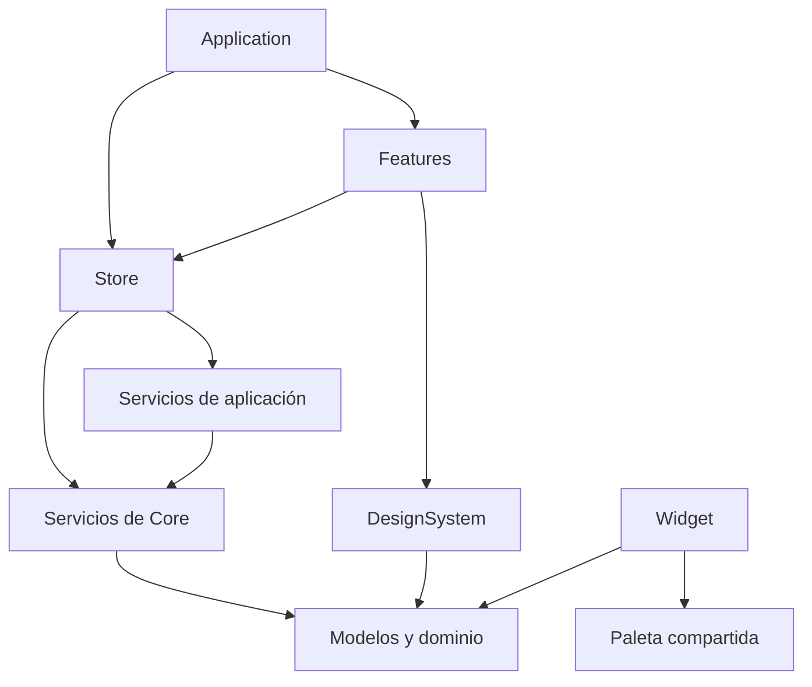

# Arquitectura

## Decisión

Organización por funcionalidad con estado observable, modelos de dominio y servicios. SwiftUI y Observation ya resuelven observación y bindings; cada vista no necesita un ViewModel dedicado. La elección mantiene la implementación actual y evita añadir capas que solo reenvían propiedades.

Esta estructura adopta la separación de responsabilidades de MVVM, pero no se presenta como una conversión completa a MVVM clásico. `Store` sigue siendo el coordinador de estado compartido; cada formulario mantiene su borrador en `@State`.

## Dependencias

- **Application:** arranque, ciclo de vida, preferencia de apariencia y navegación raíz.
- **Features:** pantallas de una funcionalidad. Cada pantalla tiene su archivo; vistas auxiliares estrechamente relacionadas pueden compartirlo.
- **State:** Store serializado en el actor principal. Valida y persiste una copia antes de publicar cambios; coordina respaldos, widget y sincronización.
- **App/Services:** integraciones ligadas a iOS, incluyendo Keychain y notificaciones. CloudSyncManager coordina los cambios de revisión y conflictos.
- **Core:** cálculo financiero, modelos Codable y servicios independientes de SwiftUI. LedgerStorage guarda atómicamente y conserva versiones. CloudClient habla HTTPS con la API, no con PostgreSQL.
- **DesignSystem:** paleta, contenedores, filas, selector de período, grilla de categorías y presentación de cuotas. Los cálculos monetarios no se trasladan a componentes visuales.
- **Widget:** target independiente que compila los modelos, operaciones y paleta que necesita, sin las pantallas de la app.

## Persistencia y compatibilidad

La reorganización no modifica los nombres Codable, IDs de gastos, identificador de Keychain, App Group, URL de apertura ni ubicación de `ledger.json`. No hay una migración del archivo de gastos por mover código entre carpetas.

La configuración personal opcional se lee de un recurso local. Sus importes y filas de origen no están embebidos en Swift ni publicados. Conserva marcadores de migración para que una actualización no repita operaciones.

## Cuándo introducir un ViewModel

Una funcionalidad que requiera varias cargas asíncronas, validación de borradores reutilizable o pruebas de estado de interfaz puede incorporar un `@Observable @MainActor` ViewModel dentro de su propia carpeta. No se replica todo el Ledger en ViewModels ni se crean Stores paralelos para un mismo archivo.

## Alcance de esta reorganización

Se separaron los archivos de pantallas, se movieron modelos/servicios/componentes a sus carpetas y se reconstruyeron los grupos de Xcode sobre el proyecto existente. No se regeneraron los targets ni la configuración de firma. La lógica financiera existente se conserva; la configuración personal se desacopló del código para permitir un repositorio público.
